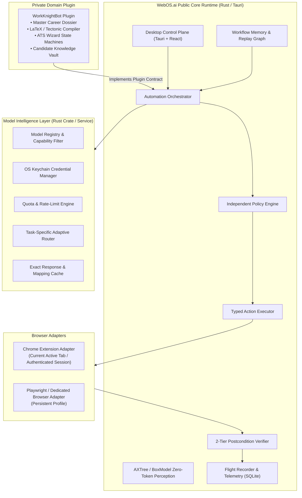

# WebOS.ai — Product Charter & Boundaries Specification
**Document Version:** 1.0.0  
**Status:** SPECIFICATION_LOCKED  
**Scope:** Core Runtime, Model Intelligence Layer, WorkKnightBot Plugin Boundary  

---

## 1. Executive Summary & Vision

**WebOS.ai** is a local-first, domain-neutral browser automation runtime. It treats the World Wide Web as an operating system application layer, enabling deterministic perception, policy-enforced action execution, postcondition verification, durable flight-recorder telemetry, and learned workflow memory.

The core runtime operates with **zero domain awareness**—it possesses no internal logic, prompts, schemas, or knowledge regarding job applications, resumes, applicant tracking systems (ATS), or user candidate profiles. 

All domain-specific behaviors (such as automated job applications, career dossier parsing, LaTeX resume compilation, and ATS wizard traversal) are encapsulated exclusively within the **WorkKnightBot** private plugin.

Between the generic automation runtime and external/local language models sits the **Model Intelligence Layer**, a standalone subsystem responsible for provider abstraction, secure credential management, rate and quota tracking, task-specific model routing, multi-model fan-out, and exact-response caching.

---

## 2. The Three-Layer Separation of Concerns

### 2.1 Layer Responsibilities & Strict Isolation

| Capability / Responsibility | WebOS.ai Core Runtime | Model Intelligence Layer | WorkKnightBot Private Plugin |
|---|:---:|:---:|:---:|
| **Browser Control & CDP** | **Primary Owner** | Non-participant | Non-participant |
| **AXTree Perception & Control Indexing** | **Primary Owner** | Non-participant | Non-participant |
| **Action Execution & Verification** | **Primary Owner** | Non-participant | Non-participant |
| **Execution Policy & User Safety Gates** | **Primary Owner** | Non-participant | Domain Rule Contributor |
| **Flight Recorder Telemetry** | **Primary Owner** | Event Producer | Event Producer |
| **Provider Credential Management** | Non-participant | **Primary Owner** | Non-participant |
| **Model Quotas, Retries & Fallbacks** | Non-participant | **Primary Owner** | Non-participant |
| **Task Routing & Cost/Latency Scoring** | Non-participant | **Primary Owner** | Request Caller |
| **Exact Task Response Caching** | Non-participant | **Primary Owner** | Cache Consumer |
| **Candidate Dossier & Profile Store** | Non-participant | Non-participant | **Primary Owner** |
| **Resume Generation (LaTeX/Tectonic)** | Non-participant | Non-participant | **Primary Owner** |
| **ATS Protocols (Workday, Greenhouse)** | Non-participant | Non-participant | **Primary Owner** |
| **Reusable Answers & Intentional Blanks**| Non-participant | Non-participant | **Primary Owner** |

---

## 3. Core Use Cases

### 3.1 Use Case 1: Instant "Fill Form" Action (Deterministic Primary Trigger)
1. **User Action**: User navigates to any web form in Chrome and clicks the persistent `Fill Form` action (via Desktop HUD or Chrome Extension toolbar).
2. **Runtime Execution**:
   - Runtime extracts page accessibility tree and active form controls in $< 50\text{ ms}$ with 0 LLM tokens.
   - Evaluates active domain against registered plugins (e.g., WorkKnightBot on `myworkdayjobs.com` or generic autofill).
   - Resolves known controls against deterministic profile mappings or previous successful traces.
   - For unknown fields, requests semantic classification from Model Intelligence Layer via canonical task schema.
   - Policy engine checks each field mutation against safe boundaries.
   - Action executor fills controls sequentially with human-like input emulation.
   - Verifier checks postconditions (`.value == target`, mutation idle, error badge absence).
   - Generates flight recorder audit event.

### 3.2 Use Case 2: Natural-Language Desktop Copilot (Conversational Trigger)
1. **User Action**: User enters prompt in Desktop Chat: *"Fill out the personal information on this page, but leave salary expectations blank until I review."*
2. **Runtime Execution**:
   - Desktop UI passes prompt and current browser snapshot to Orchestrator.
   - Model Intelligence Layer decomposes request into a validated, typed execution plan.
   - Policy Engine authorizes plan steps and enforces the explicit negative constraint (`salary == skip`).
   - Steps execute through the common execution and verification pipeline.
   - Verifier confirms state changes and returns structured execution card to Chat UI.

### 3.3 Use Case 3: Autonomous Multi-Step Wizard Traversal
1. **User Action**: Traversal across multi-page workflows (e.g., Enterprise ATS wizards, multi-page surveys).
2. **Runtime Execution**:
   - Domain plugin drives step transitions using verified state machines.
   - Repeater tables (e.g., Workday Experience `[+ Add]` blocks) handled through bounded iteration loops.
   - Runtime enforces human-in-the-loop pause gates for ambiguous fields, CAPTCHAs, or final submission.

---

## 4. System Non-Goals & Anti-Requirements

1. **No Bot Evasion / Anti-Scraping Arms Races**: WebOS.ai is an assistive local-first agent for authorized user workflows. It will not maintain stealth evasion patches or bypass systems designed to block malicious scrapers.
2. **No Unauthenticated Remote Access**: The local engine will not expose open, unauthenticated TCP or WebSocket ports accessible to arbitrary web scripts or network peers.
3. **No Autonomous Final Form Submission Without Explicit Consent**: The system will never trigger an irreversible `Submit Application` or financial transaction button without explicit, verified user authorization on the desktop control plane.
4. **No Plaintext Credential Persistence**: Cloud API keys, user passwords, and session secrets will never be stored in plaintext configuration files, database tables, or browser extension local storage.
5. **No Direct Execution of Model-Generated Code**: The system will never feed raw LLM output into an `eval()`, Python `exec()`, or arbitrary browser `Page.evaluate()` script. All model outputs must be strictly validated JSON conforming to typed action schemas.
6. **No Domain Bleed into Core Runtime**: No references to resumes, candidate records, ATS platforms, or job postings shall exist within `webos-core`, `webos-policy`, or `webos-model`.

---

## 5. Architectural Boundary Constraints

### 5.1 Public Core vs. Private WorkKnightBot
- **Public Core Repository**: Completely open-sourceable Rust runtime, Tauri desktop application, Manifest V3 Chrome extension, and general-purpose browser automation SDK.
- **Private Plugin Directory / Repository**: Contains WorkKnightBot intellectual property:
  - Personal dossier parsing algorithms.
  - Proprietary LaTeX resume templates and 1-page line budget trimming heuristics.
  - Handlers for proprietary ATS platforms (Workday, Taleo, Greenhouse, Lever, Ashby, BambooHR).
  - Private candidate knowledge vault and question-answering cache.
- **Communication Protocol**: WorkKnightBot communicates with WebOS.ai strictly via the typed **WebOS Plugin Interface** (defined in `03_IMPLEMENTATION_CONTRACTS.md`), communicating via asynchronous JSON-RPC/In-Process FFI with zero internal cyclic dependencies.
