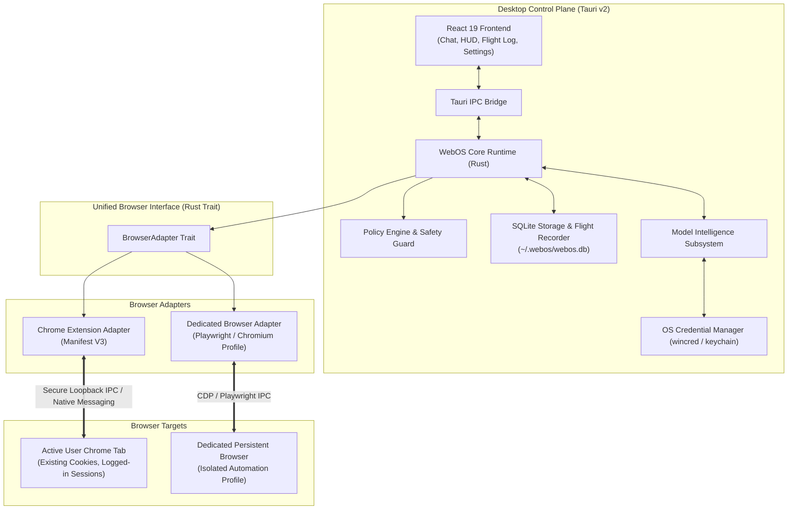
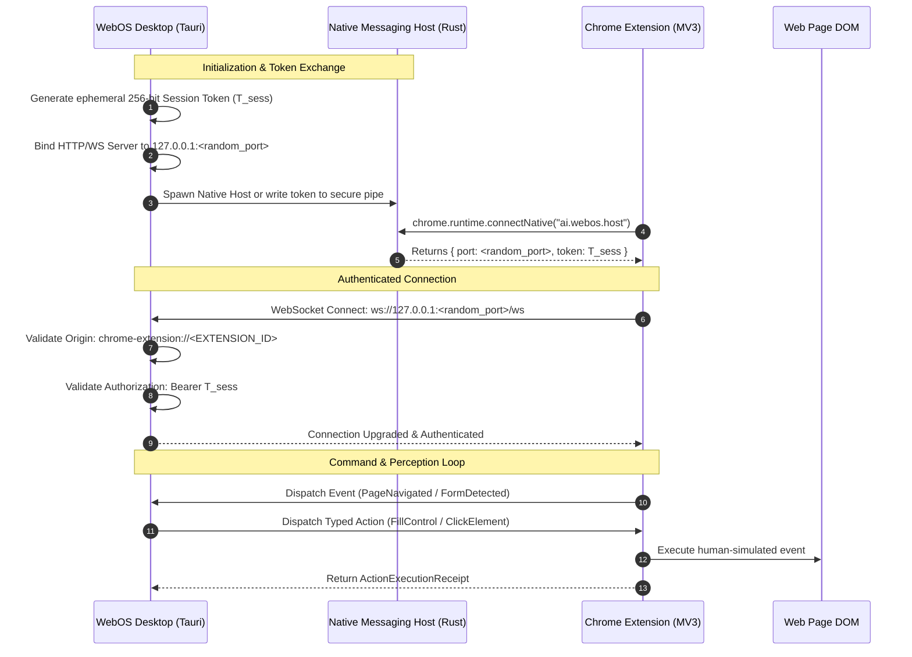
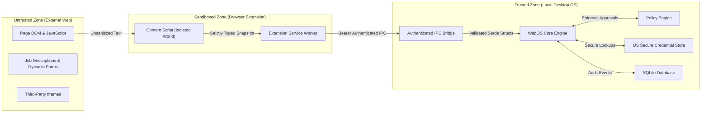

# WebOS.ai — System Architecture Specification
**Document Version:** 1.0.0  
**Status:** SPECIFICATION_LOCKED  
**Scope:** Core Architecture, Process Model, Browser Adapters, IPC Protocols, Trust Boundaries  

---

## 1. High-Level System Architecture

WebOS.ai is engineered as a local-first desktop application combining a **Tauri v2 (Rust)** core runtime with a **React 19 + TypeScript** user interface, communicating with two distinct browser automation adapters:



---

## 2. Process & Component Model

The system is decomposed into modular Rust crates within a Cargo workspace:

```
webos-runtime/
├── crates/
│   ├── webos-core/          # Orchestrator, session lifecycle, command dispatcher
│   ├── webos-types/         # Typed actions, perception schemas, error definitions
│   ├── webos-policy/        # Deterministic policy engine, confirmation rules
│   ├── webos-browser/       # Unified BrowserAdapter trait and common primitives
│   ├── webos-adapter-ext/   # Extension listener, authenticated loopback server
│   ├── webos-adapter-pw/    # Playwright / CDP persistent browser driver
│   ├── webos-storage/       # SQLite migration manager, episodic logs, skills graph
│   ├── webos-telemetry/     # Flight recorder, structured event bus, redaction
│   ├── webos-model/         # Model registry, quota manager, router, exact cache
│   └── webos-plugin-sdk/    # Typed traits and FFI bindings for plugins (WorkKnightBot)
├── src-tauri/               # Tauri application entry point and system tray
└── src/                     # React 19 + Tailwind CSS desktop UI
```

---

## 3. Browser Adapter Architecture

To support both **existing active tabs** (reusing authenticated user sessions) and **isolated automations** (for headless or repeatable batch tasks), WebOS.ai abstracts browser control behind a unified trait:

```rust
#[async_trait]
pub trait BrowserAdapter: Send + Sync {
    /// Connects to or attaches to the target browser session
    async fn attach(&mut self, session_id: &str) -> Result<SessionContext, BrowserError>;
    
    /// Captures a zero-token perception snapshot of the current viewport and active page
    async fn capture_snapshot(&self) -> Result<PageSnapshot, BrowserError>;
    
    /// Executes a typed, policy-authorized action primitive
    async fn execute_action(&self, action: &BrowserAction) -> Result<ExecutionReceipt, BrowserError>;
    
    /// Verifies postconditions following action execution
    async fn verify_state(&self, verification: &PostconditionRule) -> Result<VerificationOutcome, BrowserError>;
    
    /// Disconnects from the target session
    async fn detach(&mut self) -> Result<(), BrowserError>;
}
```

### 3.1 Adapter Comparison & Selection Matrix

| Dimension | Chrome Extension Adapter (`webos-adapter-ext`) | Dedicated Browser Adapter (`webos-adapter-pw`) |
|---|---|---|
| **Target Tab** | Active Chrome tab currently open by user | Dedicated Chromium window managed by WebOS |
| **Authentication** | Reuses user's existing cookies, SSO, 2FA, password managers | Fresh or persistent dedicated profile directory |
| **Driver Mechanism** | Chrome Extension Content Scripts + `chrome.debugger` (CDP) | Playwright Node.js Sidecar or Native Rust CDP (`chromiumoxide`) |
| **Permissions** | Restricted by Chrome Web Store MV3 manifest rules | Full local OS process permissions |
| **Best Used For** | Everyday forms, jobs requiring existing active logins, Assistive HUD | Unattended batch workflows, background monitoring, synthetic testing |

---

## 4. Extension-to-Desktop IPC Security Design

The original WebOS.ai prototype contained a critical security vulnerability: an unauthenticated local WebSocket server on a fixed port that accepted arbitrary browser debugger commands. This allowed any malicious webpage capable of running JavaScript on `localhost` to control the user's browser.

In WebOS.ai v2, this communication channel is re-architected with **defense-in-depth**:



### 4.1 Security Enforcements
1. **Dynamic Ephemeral Ports**: The loopback server never binds to a predictable fixed port; an ephemeral OS port is bound at startup.
2. **Cryptographic Ephemeral Bearer Token**: A cryptographically secure 256-bit random token is generated on every launch and passed directly to the extension via Chrome Native Messaging.
3. **Strict Origin Validation**: The desktop loopback server rejects any HTTP request or WebSocket handshake whose `Origin` header does not match the registered extension ID (`chrome-extension://<EXT_ID>`). Webpages navigating to `localhost` are immediately blocked (HTTP 403 Forbidden).
4. **No Arbitrary Script Injection**: The desktop IPC protocol permits only strictly typed action primitives (`click`, `fill`, `select`, `scroll`, `navigate`, `upload`). Commands like `eval_js` or `run_script` are explicitly excluded from the protocol.

---

## 5. Dedicated Browser Driver Decision Analysis

WebOS.ai requires a dedicated browser driver for automated batch tasks and integration testing. Two implementations were evaluated:

### Option A: Rust-Native CDP Client (`chromiumoxide` / `async-tungstenite`)
- **Pros**: Zero Node.js runtime dependency, single binary distribution, minimal memory overhead, fast startup ($< 100\text{ ms}$).
- **Cons**: Requires manual implementation of complex user emulation (e.g., realistic mouse curves, file upload chooser interceptors, multi-frame handling).

### Option B: Node.js Playwright Managed Sidecar
- **Pros**: Battle-tested selector engine, robust multi-frame and cross-browser handling, native download/upload interception, high reliability in edge cases.
- **Cons**: Adds Node.js / Playwright binary footprint ($\sim 150\text{ MB}$), IPC latency between Rust and Node process.

### Architecture Decision: Phased Driver Evolution
1. **Phase 1 (MVP)**: Implement `webos-adapter-ext` first (covers 90% of user-assistive use cases in active tabs with 0 bundle overhead).
2. **Phase 2 (Dedicated Automation)**: Provide the `BrowserAdapter` implementation via a lightweight Rust CDP client (`chromiumoxide`) for standard Chromium tasks. If complex bot-mitigated frames require Playwright's specialized driver, an optional Playwright companion sidecar will plug in via the identical `BrowserAdapter` trait without touching core runtime logic.

---

## 6. Trust Boundaries & Threat Zones



### Trust Boundary Rules:
1. **DOM is completely untrusted**: Any text read from the page (labels, placeholders, prompts) is treated as untrusted user input and sanitized against prompt-injection attacks before reaching any model.
2. **Extension is semi-trusted**: The extension cannot authorize actions or make decisions; it acts strictly as an execution organ and sensor.
3. **Policy Engine is the sole authority**: No action can be executed on any browser target without passing through the Rust Policy Engine.
