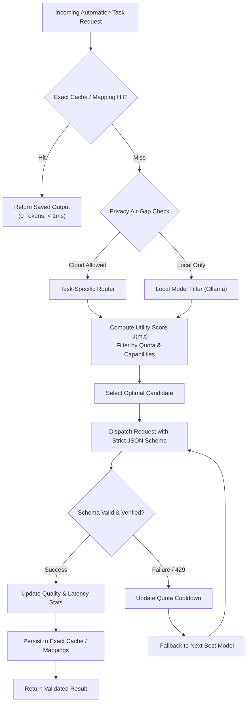

# WebOS.ai — Model Intelligence Specification
**Document Version:** 1.0.0  
**Status:** SPECIFICATION_LOCKED  
**Scope:** Model Registry, Credential Security, Quota Tracking, Routing Optimization, Caching Tiers  

---

## 1. Architectural Role & Overview

The **Model Intelligence Layer** sits between automation orchestrators (WebOS.ai Core, WorkKnightBot) and language model runtimes (local engines and cloud providers). Its primary objectives are:

1. **Eliminate LLM calls wherever deterministic rules or cached mappings suffice.**
2. **Abstract provider differences** behind typed, task-specific interfaces.
3. **Manage credentials securely** in the operating system's native keychain.
4. **Prevent rate-limit failures** through proactive quota and token tracking.
5. **Route tasks adaptively** based on measured quality, latency, cost, and privacy.



---

## 2. Model Registry & Capabilities

The registry tracks all available models across local and remote providers:

```rust
#[derive(Debug, Clone, Serialize, Deserialize)]
pub struct ModelDescriptor {
    pub provider_id: ProviderId,
    pub model_id: String,
    pub display_name: String,
    pub context_window: u32,
    pub max_output_tokens: u32,
    pub capabilities: ModelCapabilities,
    pub cost_per_1k_input: f64,
    pub cost_per_1k_output: f64,
}

#[derive(Debug, Clone, Serialize, Deserialize)]
pub struct ModelCapabilities {
    pub supports_vision: bool,
    pub supports_structured_json: bool,
    pub supports_tool_calling: bool,
    pub is_local_runtime: bool,
    pub minimum_vram_gb: Option<f32>,
}

#[derive(Debug, Clone, Copy, Serialize, Deserialize, PartialEq, Eq, Hash)]
pub enum ProviderId {
    Ollama,
    Gemini,
    Groq,
    OpenRouter,
}
```

---

## 3. Secure Credential Management

API keys and tokens are **never** persisted in configuration files, environment variables, or SQLite tables. They are stored exclusively in the host operating system's secure credential store:

* **Windows**: Windows Credential Manager (`wincred`)
* **macOS**: Apple Keychain Services (`security-framework`)
* **Linux**: FreeDesktop Secret Service API (`secret-service`)

### 3.1 Credential State & Error Classification
The credential manager distinguishes configuration faults from runtime availability issues:
* **HTTP 401 / 403 (Invalid Key)**: Marks the credential as `ConfigurationError` and notifies user in the desktop UI; **does not** trigger retry loops or rate-limit cooldowns.
* **HTTP 429 (Rate Limit / Quota Exhaustion)**: Marks the model/provider as `TemporarilyExhausted` with an exponential cooldown timer.

---

## 4. Quota & Rate-Limit Tracking

To avoid provider lockouts, the Quota Manager enforces a sliding-window tracker at multiple scopes:

```rust
#[derive(Debug, Clone, Serialize, Deserialize)]
pub struct QuotaWindow {
    pub provider: ProviderId,
    pub model_id: String,
    pub requests_last_minute: u32,
    pub rpm_limit: u32,
    pub tokens_last_minute: u32,
    pub tpm_limit: u32,
    pub requests_today: u32,
    pub rpd_limit: Option<u32>,
    pub cooldown_until: Option<u64>,
}
```

When selecting a model, any candidate exceeding $90\%$ of its sliding window is deprioritized or queued, allowing automated round-robin rotation across authorized alternative providers.

---

## 5. Task-Specific Routing & Utility Objective

The router treats model selection as an optimization problem constrained by privacy and capability requirements:

### 5.1 Objective Function
For a given task $t$ and candidate model $m$:
$$U(m, t) = Q(m, t) - \lambda L(m, t) - \mu C(m, t)$$

Where:
* $Q(m, t) \in [0.0, 1.0]$: Historical measured quality and schema compliance on task $t$.
* $L(m, t)$: Measured average round-trip latency in seconds.
* $C(m, t)$: Cost per invocation in USD (0.0 for local models).
* $\lambda, \mu$: User-configurable trade-off weights (e.g., Favor Speed vs. Favor Economy).

### 5.2 Hard Eligibility Gates (Pre-Scoring)
A model is disqualified immediately if:
1. **Privacy Gate**: Task involves sensitive candidate data and request privacy is set to `LocalOnly`, but candidate $m$ is cloud-hosted.
2. **Capability Gate**: Task requires structured JSON or vision, but candidate $m$ lacks the capability.
3. **Quota Gate**: Candidate $m$ is currently in rate-limit cooldown.

---

## 6. Canonical Tasks & Strict Schemas

Automation requests are never open-ended chat prompts. Every request conforms to a versioned **Canonical Task**:

### Task: `classify_form_field` (Form Perception Mapping)
* **Input Schema**:
```json
{
  "task": "classify_form_field",
  "version": "1.0",
  "field_label": "Years of professional Rust experience",
  "tag_name": "input",
  "input_type": "number",
  "role": "spinbutton",
  "section": "Technical Qualifications",
  "options": []
}
```
* **Output Schema (Enforced via Grammar / Schema)**:
```json
{
  "category": "years_experience",
  "target_topic": "rust",
  "suggested_profile_key": "experience.tech_stack.rust.years",
  "confidence": 0.95,
  "requires_user_confirmation": false
}
```

---

## 7. Caching Architecture & Workflow Memory

Caching operates in three prioritized tiers to minimize inference cost and latency:

```
[ Incoming Request ]
        │
        ▼
[ Tier 1: Exact Canonical Response Cache ]  ──► Hit? ──► Return Saved Result (0 Tokens)
        │ Miss
        ▼
[ Tier 2: Learned Automation Mappings ]    ──► Hit? ──► Deterministic Local Fill (0 Tokens)
        │ Miss
        ▼
[ Tier 3: Model Inference Dispatch ]
```

### 7.1 Tier 1: Exact Canonical Task Cache
* **Cache Key Computation**:
  $$\text{Key} = \text{SHA-256}(\text{CanonicalTaskJSON} + \text{SchemaVersion} + \text{ModelID} + \text{GenerationParams})$$
* **Storage**: Fast key-value table in local SQLite (`cached_model_responses`).

### 7.2 Tier 2: Learned Automation Mappings
When a field is successfully classified, filled, verified, and approved by the user, WebOS saves an explicit mapping:
```sql
CREATE TABLE learned_field_mappings (
    id TEXT PRIMARY KEY,
    domain_pattern TEXT NOT NULL,       -- e.g. "*.myworkdayjobs.com"
    field_role TEXT NOT NULL,           -- e.g. "textbox"
    normalized_label TEXT NOT NULL,     -- e.g. "years of experience"
    section_context TEXT,               -- e.g. "work history"
    profile_key TEXT NOT NULL,          -- e.g. "candidate.experience.total_years"
    verification_count INTEGER DEFAULT 1,
    last_verified_at INTEGER NOT NULL
);
```
Subsequent encounters with matching controls on the same domain or platform are resolved **deterministically from SQLite in $< 1\text{ ms}$ with 0 tokens consumed.**
