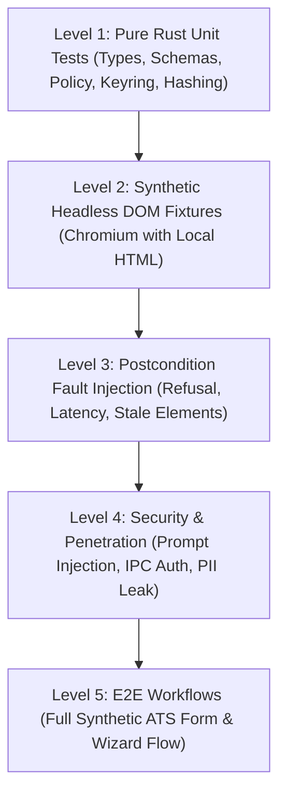

# WebOS.ai — Test & Acceptance Plan
**Document Version:** 1.0.0  
**Status:** SPECIFICATION_LOCKED  
**Scope:** Test Pyramid, Synthetic Fixtures, Verification Harness, Security Assertions, Acceptance Criteria  

---

## 1. Test Architecture & Methodology

Reliability in browser automation cannot be established through mocked unit tests alone. WebOS.ai enforces a **5-tier testing pyramid**, emphasizing synthetic deterministic browser fixtures that run locally without external network dependencies:



---

## 2. Test Levels & Coverage Requirements

### 2.1 Level 1: Pure Unit Test Suite (`cargo test`)
* **Typed Serde Round-Trips**: Assert that all `BrowserAction`, `PageSnapshot`, and `PolicyDecision` variants serialize and deserialize losslessly.
* **Exact Cache Key Hashing**: Assert identical SHA-256 hashes for equivalent canonical task JSON payloads regardless of key ordering.
* **PII Redaction & Re-hydration**: Assert 100% entity masking for emails, phones, and addresses, and verify that re-hydration restores original values without string corruption.
* **Policy Rule Evaluation**: Assert that actions containing submit keywords (`submit`, `apply`, `checkout`) always return `RequiresUserConfirmation`.

### 2.2 Level 2: Synthetic Local DOM Integration Suite
Integration tests launch a headless Chromium instance pointed at local static HTML fixtures:

```
tests/fixtures/
├── html5_basic_form.html          # Standard text, number, email, date, radio, select
├── dynamic_react_combobox.html    # Asynchronous autocomplete dropdown requiring keystrokes
├── shadow_dom_inputs.html         # Custom Web Components with nested Shadow Roots
├── multi_page_wizard/             # Step 1 (Personal) -> Step 2 (Experience) -> Step 3 (Review)
└── adversarial_injection.html    # Hidden text containing prompt-injection payloads
```

* **Zero-Token Perception Assertion**: Verifies that `capture_snapshot` indexes all interactive controls in $< 50\text{ ms}$ and $< 500$ tokens of equivalent compact JSON.
* **Action Execution Receipt Assertion**: Verifies that human-emulated typing triggers native `input`, `change`, and `blur` events on React/Vue listeners.

### 2.3 Level 3: Postcondition Fault Injection Tests
Validates that the Verifier accurately detects and flags failures rather than falsely reporting success:
* **Fault 1 (Read-Only Element)**: Typing into a `readonly` or disabled field must fail Tier-1 verification with `VerificationOutcome::Failed`.
* **Fault 2 (Network Hang)**: Clicking a submit button that spins indefinitely must trigger `VerificationOutcome::Timeout` after the configured timeout period.
* **Fault 3 (Validation Error Appearance)**: Assert that if a form shows a red error banner (`"This field is required"`), the verifier marks the step failed.

### 2.4 Level 4: Security & Penetration Suite
* **Loopback Port Isolation**:
  * Attempt connection from non-extension origin (`Origin: https://evil.com`) $\implies$ Assert immediate HTTP 403.
  * Attempt connection without Bearer token $\implies$ Assert immediate rejection.
  * Attempt sending unmapped JSON command (`{"action": "eval_js"}`) $\implies$ Assert schema validation failure.
* **Prompt Injection Defense**:
  * Execute classification on `adversarial_injection.html` $\implies$ Assert that model output is strictly constrained to allowed categories (`years_experience`, `unknown`), ignoring embedded malicious instructions.

---

## 3. Measurable Acceptance Criteria (Definition of Done)

Before any feature milestone is marked complete, it must satisfy these objective metrics:

| Metric | Target Threshold | Verification Method |
|---|---|---|
| **Perception Speed** | $< 50\text{ ms}$ on 10,000 DOM nodes | Benchmark test with synthetic complex DOM |
| **Perception Token Cost** | **0 LLM Tokens** | Telemetry token counter = 0 |
| **Tier-1 Verification Accuracy** | $100\%$ on standard HTML5 form controls | Level 2 synthetic test suite pass |
| **Postcondition Defect Detection** | $0$ false-positive submissions reported | Level 3 fault injection test suite |
| **Loopback Security Rejection** | $100\%$ of unauthorized origin / missing token requests rejected | Automated security test suite |
| **PII Air-Gap Compliance** | $0$ raw emails, phones, or addresses in cloud model payloads | Automated network traffic inspector test |
| **Irreversible Action Interception** | $100\%$ of submit/pay actions trigger confirmation gate | Policy engine unit & integration tests |
| **Learned Mapping Speedup** | $< 1\text{ ms}$ resolution, 0 tokens on repeated form | SQLite lookup benchmark |
