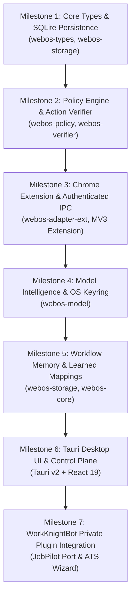

# WebOS.ai — Migration & Rust Learning Plan
**Document Version:** 1.0.0  
**Status:** SPECIFICATION_LOCKED  
**Scope:** Python Prototype Porting Audit, Rust Learning Path, Phased Implementation Milestones  

---

## 1. Prototype Audit & Porting Strategy

The existing Python prototypes (`manish465/WebOS.ai` and `manish465/JobPilot.ai`) serve as valuable algorithmic references. However, code will **not** be blindly translated line-by-line; architectural defects identified during the codebase review will be systematically resolved during the Rust port.

### 1.1 Python `WebOS.ai` Reference Mapping

| Python Module (`WebOS.ai`) | Rust Crate Target (`WebOS.ai v2`) | Architectural Improvements in Port |
|---|---|---|
| `browser/cdp_client.py` | `webos-adapter-ext` / `webos-adapter-pw` | Replaced unauthenticated socket with secure authenticated loopback and typed action protocol. |
| `browser/perception.py` | `webos-browser` | Implemented strict bounding-box zero-token filtering; rankings based on semantic roles rather than arbitrary DOM caps. |
| `browser/executor.py` | `webos-browser` | Added full `select` and file `upload` support; human-like keystroke distributions; coordinates refreshed before click. |
| `browser/verifier.py` | `webos-verifier` | Eliminated `"document ready"` false positives; enforces explicit postconditions (`.value == expected`, mutation idle). |
| `storage/db.py` & `episodic_memory.py` | `webos-storage` | Typed Serde JSON storage in SQLite; strict provenance separation between verified facts and ephemeral observations. |
| `gateway/router.py` & `key_ring.py` | `webos-model` | Secure OS keychain integration (`keyring-rs`); enforced sliding-window quotas; adaptive utility routing. |
| `gateway/sanitizer.py` | `webos-model` | Upgraded regex sanitizer to Presidio/local entity recognizers with full client-side token re-hydration. |

### 1.2 Python `JobPilot.ai` Reference Mapping (Private Plugin)

| Python Module (`JobPilot.ai`) | WorkKnightBot Target | Architectural Improvements in Port |
|---|---|---|
| `dossier/dossier_parser.py` | WorkKnightBot Dossier Parser | Preserves markdown master dossier structure; adds strict schema validation and verification timestamps. |
| `compiler/tectonic_runner.py` & `line_budget.py` | WorkKnightBot Resume Compiler | Retains Overleaf LaTeX template and 1-page line budget trimming; compiles via standalone Tectonic binary. |
| `ats/archetype2_workday.py` | WorkKnightBot Workday State Machine | Fixes incomplete wizard progression; implements deterministic multi-page step state machine and repeater loops. |
| `memory/profile_vault.py` & `blank_rules.py` | WorkKnightBot Knowledge Vault | Strictly separates verified personal facts from historical observations; enforces intentional blank rules. |
| `pilot.py` | WorkKnightBot Core Driver | Decoupled from Python wheels; communicates with WebOS.ai strictly via the typed `WebOSPlugin` interface. |

---

## 2. Phased Rust Implementation Milestones

To master Rust systematically while maintaining high code quality and zero cognitive overload, development is organized into 7 sequential, self-verifying milestones:

---

### Milestone 1: Typed Contracts & SQLite Persistence
* **Target Crates**: `crates/webos-types`, `crates/webos-storage`
* **Rust Learning Concepts**: Enums with data, Serde serialization/deserialization, Struct derives, SQLite connections with `rusqlite`, error handling with `thiserror`.
* **Deliverables**:
  - Full definition of `BrowserAction`, `PageSnapshot`, `FormControlEvidence`, and `FlightRecordEvent`.
  - SQLite database migration script creating tables: `flight_records`, `learned_field_mappings`, `cached_model_responses`.
  - Level 1 unit test suite verifying lossless Serde serialization and SQLite roundtrips.
* **Verification Command**: `cargo test -p webos-types -p webos-storage`

---

### Milestone 2: Policy Engine & Postcondition Verifier
* **Target Crates**: `crates/webos-policy`, `crates/webos-verifier`
* **Rust Learning Concepts**: Pattern matching, trait definitions, deterministic state machines, pure functions.
* **Deliverables**:
  - `PolicyEngine::evaluate_action` checking for irreversible triggers (`submit`, `pay`, `delete`).
  - `ActionVerifier::verify` evaluating postconditions (`ValueReflected`, `AttributeToggled`, `UrlChanged`).
  - Unit tests with simulated synthetic states and intentional fault injections.
* **Verification Command**: `cargo test -p webos-policy -p webos-verifier`

---

### Milestone 3: Chrome Extension Adapter & Authenticated IPC
* **Target Crates**: `crates/webos-adapter-ext`, `extension/` (Manifest V3)
* **Rust Learning Concepts**: Asynchronous networking with `tokio`, WebSockets with `tokio-tungstenite`, Native Messaging stdin/stdout protocol, cryptographic token generation (`ring` / `rand`).
* **Deliverables**:
  - Rust Native Messaging host generating 256-bit ephemeral bearer tokens and returning port to extension.
  - Desktop authenticated loopback WebSocket server enforcing `Origin: chrome-extension://<EXT_ID>`.
  - TypeScript Manifest V3 extension script injecting content observer and reporting typed `PageSnapshot`.
  - End-to-end integration test verifying bidirectional ping-pong between extension and Rust host.

---

### Milestone 4: Model Intelligence Layer & OS Keyring
* **Target Crates**: `crates/webos-model`
* **Rust Learning Concepts**: Async HTTP requests with `reqwest`, JSON Schema validation, secure OS credential storage via `keyring-rs`, sliding-window rate limiters.
* **Deliverables**:
  - `KeyRingManager` reading and writing API keys to Windows Credential Manager / macOS Keychain.
  - Sliding-window rate limiter enforcing RPM/TPM bounds for Gemini, Groq, and Ollama.
  - Exact Response Caching engine hashing canonical task JSON payloads.
  - Unit test verifying identical cache key generation and rate-limit cooldown transitions.
* **Verification Command**: `cargo test -p webos-model`

---

### Milestone 5: Workflow Memory & Learned Field Mappings
* **Target Crates**: `crates/webos-storage`, `crates/webos-core`
* **Rust Learning Concepts**: SQL indexing, caching strategies, parameterized replay graphs.
* **Deliverables**:
  - Learned field mapping lookup resolving known controls in $< 1\text{ ms}$ with 0 tokens.
  - Recording pipeline storing successful traces and user-approved field values.
  - Benchmark test proving deterministic bypass of model calls on subsequent encounters.

---

### Milestone 6: Tauri v2 Desktop Control Plane & UI Shell
* **Target Projects**: `src-tauri/`, `src/` (React 19 + Tailwind)
* **Rust/TS Concepts**: Tauri commands (`#[tauri::command]`), IPC state management, global shortcut registration, floating canvas overlay.
* **Deliverables**:
  - Desktop UI featuring: Chat Copilot tab, Form Inspection card, Flight Log viewer, Provider Settings.
  - Persistent `Fill Form` trigger button.
  - Emergency Pause / Stop hotkey listener (`Ctrl+Shift+Space`).

---

### Milestone 7: WorkKnightBot Private Plugin Integration
* **Target Directory**: `plugins/workknightbot/`
* **Concepts**: Modular plugin interface, external CLI execution (`tectonic`), ATS state machine execution.
* **Deliverables**:
  - Implementation of `WebOSPlugin` trait in WorkKnightBot.
  - LaTeX template compilation and 1-page line budget verification via local Tectonic binary.
  - Workday wizard multi-step traversal integration test against local synthetic HTML fixtures.
